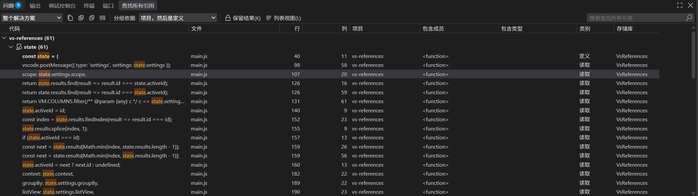

# FindAllReferences

**English** | [简体中文](README.zh-CN.md)

A VS Code extension that recreates the Visual Studio **Find All References** window. Reference locations come from the active language service (for C#, the C# Dev Kit / C# extension; other languages work the same way), and the results appear in the **Find All References** tab in the panel.



## Usage

- Put the cursor on a symbol and press **Shift+F12**, or choose **Find All References (VS Style)** from the editor context menu.
- While results are shown, **F4 / Shift+F4** moves to the next / previous reference (collapsed groups expand automatically).
- Both shortcuts can be turned off in settings: `findAllReferences.useShiftF12` and `findAllReferences.useF4Navigation`.

## Language

The window is available in English and Chinese. The `findAllReferences.language` setting controls it:

| Value | Language |
| --- | --- |
| `auto` (default) | Follows the VS Code display language: Chinese when VS Code is in Chinese, English otherwise |
| `zh-cn` | Chinese |
| `en` | English |

Changing it takes effect immediately, including for results already in the window and the panel tab title ("Find All References" / 「查找所有引用」). Command names and the settings page itself always follow the VS Code display language, because VS Code reads them before the extension runs.

## Window features

| Feature | Description |
| --- | --- |
| Columns | Code, File, Line, Column, Project, Containing Member, Containing Type, Kind, Repository; plus a Path column hidden by default |
| Scope | Entire Solution, Current Project, Current Document, Open Documents, Changed Documents (Git) |
| Group by | Project then Definition / Definition only / Definition then Project / Definition then Path / Definition, Project then Path |
| List view (Alt+L) | Flat, ungrouped list |
| Keep results (Alt+K) | Once the current tab is kept, the next search opens a new tab; close tabs with middle-click or × |
| Column filters | Funnel icon in the header with Excel-style checkboxes; "Clear All Filters" also clears the search box |
| Sorting | Click a header for ascending → descending → back to the default (path, line, column) |
| Column width and visibility | Drag a header divider to resize, double-click it to auto-fit; right-click the header to choose visible columns |
| Search | The search box at the top right filters on the text of every column (Ctrl+F) |
| Copy | Toolbar button or Ctrl+C copies the selected rows (selecting a group copies everything under it), tab-separated with a header row |
| Keyboard | Up / Down / PageUp / PageDown / Home / End move and preview, Left / Right collapse and expand, Enter opens, Ctrl+A selects all |

Single-clicking an entry opens it in a preview tab and keeps focus in the window; double-click or Enter opens it and moves focus to the editor.

## Where each column comes from

- **Project**: scans the workspace's `.csproj` files. Unity-generated projects list each `<Compile Include>`, so files are mapped exactly from that list (for example `Assembly-CSharp`, `Assembly-CSharp-Editor`); SDK-style projects are mapped by folder; C# files that belong to no project go under "Miscellaneous Files"; for other languages, the name from the nearest `package.json` or the folder containing the nearest project marker file is used.
- **Containing Member / Containing Type**: the innermost member and type in the document symbol tree that contain the location; nested types are joined with dots.
- **Kind**: language services don't report usage kinds, so a single-line heuristic modelled on Roslyn's categories is used. Types: qualified, type argument, object creation, base, type constraint, import, name. Values such as fields and properties: read, write, read/write (combined with read/write information from document highlights). The declaration is marked "definition". Results may differ from Visual Studio's exact classification.
- **Repository**: the root folder name of the repository reported by the built-in Git extension.

## Development

```bash
npm install
npm test
npm run package
```

`npm test` compiles and runs three test suites: pure functions on the extension side (kinds, symbol chains, project mapping), the view model (scope, filtering, sorting, grouping, copying), and a webview smoke test in jsdom. `npm run package` produces `find-all-references-<version>.vsix`, which you can install in VS Code with **Install from VSIX**.
