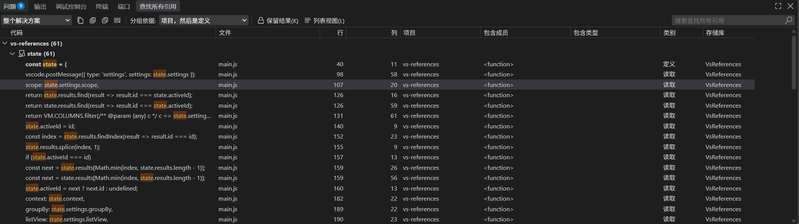

# FindAllReferences

[English](README.md) | **简体中文**

仿 Visual Studio「查找所有引用」窗口的 VS Code 扩展。引用位置来自当前语言服务（C# 用 C# Dev Kit／C# 扩展，其他语言同理），结果显示在面板里的「查找所有引用」页签中。



## 用法

- 光标放在符号上，按 **Shift+F12**，或在编辑器右键菜单选「查找所有引用（VS 风格）」。
- 有结果时 **F4／Shift+F4** 在引用间前后跳转（折叠的组会自动展开）。
- 两个快捷键都可在设置里关掉：`findAllReferences.useShiftF12`、`findAllReferences.useF4Navigation`。

## 语言

窗口支持中文和英文，由设置 `findAllReferences.language` 控制：

| 取值 | 语言 |
| --- | --- |
| `auto`（默认） | 跟随 VS Code 的显示语言：中文界面用中文，其他用英文 |
| `zh-cn` | 中文 |
| `en` | 英文 |

修改后立即生效，窗口里已有的结果和面板页签标题（「查找所有引用」／Find All References）都会切换。命令名和设置页面本身始终跟随 VS Code 的显示语言，因为 VS Code 在扩展运行前就读取它们。

## 窗口功能

| 功能 | 说明 |
| --- | --- |
| 列 | 代码、文件、行、列、项目、包含成员、包含类型、类别、存储库；另有默认隐藏的「路径」列 |
| 范围 | 整个解决方案、当前项目、当前文档、打开的文档、已更改的文档（Git） |
| 分组依据 | 项目，然后是定义／仅定义／定义，然后是项目／定义，然后是路径／定义、项目，然后是路径 |
| 列表视图 (Alt+L) | 不分组的平铺列表 |
| 保留结果 (Alt+K) | 当前页签被保留后，下次查找开新页签；页签可中键或 × 关闭 |
| 列筛选 | 表头漏斗图标，Excel 式勾选；「清除所有筛选器」同时清空搜索框 |
| 排序 | 单击表头升序 → 降序 → 恢复默认（路径、行、列） |
| 列宽与显隐 | 拖动表头分隔线调宽，双击分隔线自适应；表头右键勾选显示的列 |
| 搜索 | 右上角搜索框按所有列文本过滤 (Ctrl+F) |
| 复制 | 工具栏按钮或 Ctrl+C，复制选中行（选中分组即其下全部条目），制表符分隔带表头 |
| 键盘 | 上下／PageUp／PageDown／Home／End 移动并预览，左右折叠展开，Enter 打开，Ctrl+A 全选 |

单击条目在预览页签打开且焦点留在窗口，双击或 Enter 打开并切到编辑器。

## 各列的来源

- **项目**：扫描工作区的 `.csproj`。Unity 生成的工程逐个列出 `<Compile Include>`，按清单精确映射（如 `Assembly-CSharp`、`Assembly-CSharp-Editor`）；SDK 风格工程按目录映射；不在任何工程里的 C# 文件归「杂项文件」；其他语言取最近的 `package.json` 名称或工程标记文件所在目录名。
- **包含成员／包含类型**：文档符号树中包含该位置的最内层成员与类型，嵌套类型用点连接。
- **类别**：语言服务不提供用法分类，按 Roslyn 的分类做单行启发式判断——类型：合格、类型参数、对象创建、基、类型约束、导入、名称；字段／属性等值：读取、写入、读取/写入（结合文档高亮的读写信息）；定义处标「定义」。与 Visual Studio 的精确结果可能有出入。
- **存储库**：内置 Git 扩展给出的仓库根目录名。

## 开发

```bash
npm install
npm test
npm run package
```

`npm test` 编译后跑三组测试：扩展端纯函数（类别、符号链、工程映射）、视图模型（范围、筛选、排序、分组、复制）、jsdom 里的 Webview 冒烟。`npm run package` 生成 `vs-find-all-references-<版本>.vsix`，在 VS Code 里用「从 VSIX 安装」装上即可。
